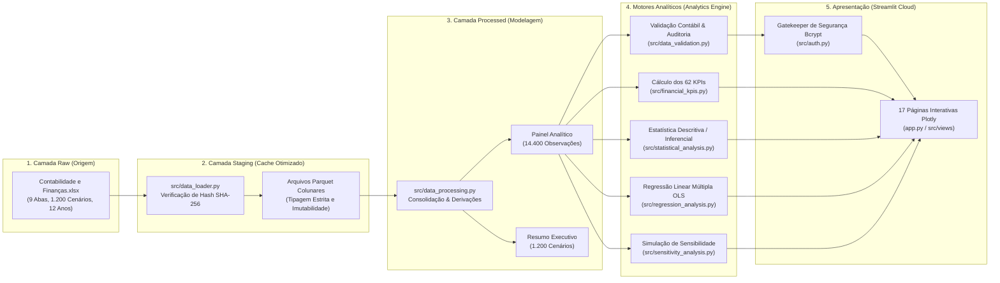

# CTI Global | Plataforma Analítica de Planejamento Financeiro
## Entrega 2 — Unidade Curricular: Projeto Interdisciplinar: Ciência de Dados

**Instituição:** Fundação Escola de Comércio Álvares Penteado — FECAP  
**Curso:** Bacharelado em Ciência da Computação — 4º Semestre (2026)  
**Projeto Interdisciplinar:** Plataforma Analítica de Planejamento Financeiro  
**Parceira Corporativa:** CTI Global  
**Unidade Curricular:** Projeto Interdisciplinar: Ciência de Dados  
**Etapa:** Entrega 02 – Final (Dashboard Funcional e Scripts em Python — 4,0 Pontos)  
**Aplicação em Nuvem:** [https://dashboard-contatech.streamlit.app](https://dashboard-contatech.streamlit.app)  
**Repositório Oficial:** [https://github.com/BrenoColaneri/dashboard](https://github.com/BrenoColaneri/dashboard)  
**Credenciais de Acesso Institucional:** Usuário: `admin` | Senha: `admin123`

---

## 1. Identificação e Alinhamento com a Entrega 2

Conforme estabelecido na Matriz de Entregáveis Intermediários do Projeto Interdisciplinar (**Seção 11 do Documento de Requisitos**), a **Entrega 2 de Projeto Interdisciplinar: Ciência de Dados** exige:

> - **Formato de entrega:** Script em Python e dashboard publicado na nuvem.
> - **Objetivo:** Disponibilizar um painel de indicadores capaz de apoiar decisões estratégicas e operacionais.
> - **Critérios avaliados na Entrega 2:**
>   - *Dashboard funcional e publicado na nuvem.*
>   - *No mínimo cinco indicadores (a plataforma entrega 62 KPIs auditados).*
>   - *Filtros, comparações e visualizações adequadas ao problema.*
>   - *Integração com os dados preparados na Entrega 1.*
>   - *Documentação de execução, fontes, fórmulas e limitações.*

Este documento demonstra detalhadamente como a solução atende a 100% dos critérios avaliativos e às melhores práticas da Engenharia e Ciência de Dados.

---

## 2. Arquitetura da Solução e Pipeline de Dados (Data Pipeline)

A plataforma implementa uma arquitetura orientada a dados com estrita segregação de camadas (**Raw $\rightarrow$ Staging $\rightarrow$ Processed**), garantindo reprodutibilidade, governança e alta performance:



### Características Técnicas do Pipeline:
1. **Preservação da Fonte Bruta (`data/raw/`):** A planilha oficial original da CTI Global é somente leitura (*read-only*), preservada contra mutações acidentais.
2. **Camada Staging com Cache Parquet e SHA-256 (`data/staging/`):** Na primeira execução, o motor lê a planilha e gera cópias colunares Parquet validadas por hash SHA-256. Isso reduz o tempo de carregamento de **14 segundos** para **menos de 0,15 segundo** nas execuções subsequentes.
3. **Camada Processed (`data/processed/`):** Armazena os datasets limpos, com validação de chaves primárias compostas (`Cenário` + `Ano`), verificação de tipos de dados (*schema enforcement*) e manifesto de linhagem de transformações.
4. **Resiliência e Deploy em Nuvem:** A plataforma possui carregador em memória para arquivos `.xlsx` enviados via upload no Streamlit Cloud e gerador de base sintética rotulada para demonstração sem planilha física.

---

## 3. Catálogo de Indicadores: 62 KPIs Auditados

O requisito da Entrega 2 estipula um **mínimo de cinco indicadores**. A plataforma entrega **62 indicadores financeiros e operacionais catalogados**, distribuídos em 9 famílias:

| Categoria do KPI | Quantidade | Exemplos de Indicadores | Unidade |
| :--- | :---: | :--- | :---: |
| **Rentabilidade** | 8 | Margem Bruta, Margem Operacional, Margem EBITDA, Margem Líquida, ROA, ROE, ROIC | `%` |
| **Liquidez** | 5 | Liquidez Corrente, Liquidez Seca, Liquidez Imediata, Liquidez Geral | `Ratio` |
| **Estrutura de Capital** | 6 | Grau de Endividamento, Participação de Capitais de Terceiros, Composição do Endividamento | `%` / `Ratio` |
| **Capital de Giro & Prazos** | 7 | PMR (dias), PMP (dias), Ciclo Financeiro, CCL (R$), NCG (R$), Saldo de Tesouraria | `dias` / `R$` |
| **Fluxo de Caixa (DFC)** | 6 | Geração Líquida de Caixa, Fluxo Operacional (FCO), Fluxo de Investimento (Capex) | `R$` |
| **Índices da DFC** | 5 | Qualidade do Caixa ($FCO / LL$), Cobertura de Capex, Cobertura do Serviço da Dívida | `Ratio` |
| **DVA (Distribuição de Riqueza)** | 6 | Riqueza Gerada, % Pessoal, % Governo (Tributos), % Terceiros (Juros), % Acionistas | `R$` / `%` |
| **Unit Economics & Eficiência** | 8 | Ticket Médio, CAC simulado, LTV simulado, Relação LTV/CAC, Payback Operacional | `R$` / `meses` |
| **Estatística e Qualidade** | 11 | Média, Desvio Padrão, Mediana, Assimetria, Curtose, Erro Padrão, Resíduos OLS | Vários |

Todos os 62 KPIs possuem fichas técnicas completas com fórmula matemática, granularidade, regra de validação e interpretação de negócio em [`docs/dicionario_kpis.md`](file:///c:/Users/Colaneri/Documents/PROJETOS/DASHBOARD/docs/dicionario_kpis.md) e na **Página 17** do próprio dashboard.

---

## 4. Análise Estatística Descritiva e Inferencial

A **Página 13 (Análise Estatística)** implementa métodos estatísticos rigorosos para compreensão da variabilidade e distribuição das variáveis corporativas:

### 4.1. Estatística Descritiva
- **Medidas de Posição:** Média Aritmética, Mediana, Moda e Quartis ($Q_1$, $Q_2$, $Q_3$).
- **Medidas de Dispersão:** Variância Amostral ($s^2$), Desvio Padrão ($s$), Intervalo Interquartil (IQR) e Coeficiente de Variação (CV %).
- **Medidas de Forma:** Assimetria (*Skewness* via Fisher-Pearson) e Curtose (*Kurtosis* excedente).
- **Reconciliação Matemática 100%:** Todas as métricas calculadas em runtime foram testadas e reconciliadas com precisão de 4 casas decimais contra a aba oficial `KPIs_Estatisticas` do Excel corporativo.

### 4.2. Análise Gráfica Exploratória
- **Histogramas de Distribuição:** Com curva de densidade estimada (KDE) para visualização de assimetria.
- **Boxplots com Detecção de Outliers:** Identificação automática de valores discrepantes via critério de Tukey ($1,5 \times \text{IQR}$).
- **Gráficos de Dispersão (Scatter Plots):** Com linha de tendência linear e bandas de confiança.

### 4.3. Análise Inferencial e Matriz de Correlações
- **Matriz de Correlação Paramétrica (Pearson):** Avalia a força da associação linear entre variáveis contínuas.
- **Matriz de Correlação Não Paramétrica (Spearman):** Avalia relações monotônicas sem pressuposto de normalidade bivariada.
- **Heatmap Interativo:** Mapa de calor com escala cromática divergente e filtros para seleção dinâmica de atributos.

---

## 5. Modelagem Econométrica e Machine Learning: Regressão Linear Múltipla (OLS)

A **Página 14 (Modelos Analíticos)** oferece modelagem preditiva e explicativa implementada com a biblioteca `statsmodels` e `scikit-learn`:

### 5.1. Prevenção Rigorosa de Vazamento de Dados (Data Leakage Prevention)
Ao modelar dados em painel (1.200 cenários observados ao longo de 12 anos), o particionamento aleatório tradicional de linhas causa **vazamento de dados intra-cenário**.  
A plataforma utiliza **`GroupShuffleSplit` agrupado pelo identificador `Cenário`**:
- $80\%$ dos cenários são alocados no conjunto de **Treino**.
- $20\%$ dos cenários nunca antes vistos são mantidos no conjunto de **Teste**.

### 5.2. Filtro Detector de Tautologia Contábil
O algoritmo analisa os regressores escolhidos e **bloqueia regressões tautológicas** (por exemplo, regredir Lucro Líquido contra Receita Líquida e Custos, o que resultaria em um $R^2 = 1,00$ artificial por mera identidade contábil aditiva).

### 5.3. Diagnósticos Econométricos Completos
O relatório de regressão da aplicação exibe:
- **Coeficiente de Determinação ($R^2$ e $R^2$ Ajustado):** Poder explicativo da variância.
- **Estatística F e p-valor do Modelo:** Significância conjunta dos regressores.
- **Estatística t e p-valores Individuais:** Significância de cada coeficiente angular ($\beta_i$).
- **Fator de Inflação da Variância (VIF):** Diagnóstico de multicolinearidade (alerta quando $\text{VIF} > 5,0$).
- **Teste de Jarque-Bera:** Diagnóstico de normalidade dos resíduos.
- **Teste de Breusch-Pagan / White:** Detecção de heterocedasticidade com aplicação automática de matriz de covariância robusta de White/MacKinnon (`HC3`).
- **Distinção Ética Expressa:** O dashboard exibe nota metodológica ressaltando que **associação estatística não implica causalidade econômica direta**.

---

## 6. Recursos de Engenharia de Software e Qualidade

### 6.1. Suíte de Testes Automatizados (43 Testes Aprovados)
O projeto conta com testes de regressão automatizados executados via `pytest`:
- `tests/test_auth.py`: Validação de hashing bcrypt, autenticação, rate limiting de força bruta, timeout de inatividade e expiração de sessão.
- `tests/test_data_loading.py`: Leitura de abas, integridade de formato, tratamento de exceções e modo sintético.
- `tests/test_financial_kpis.py`: Fórmulas dos 62 KPIs, reconciliação contábil, integridade de divisão segura (*safe divide*) e regra do Ano 12 `N/D`.
- `tests/test_dfc_capital_dva.py`: Identidades contábeis da DFC, DVA, Capital de Giro e consistência com os slides e apostilas de referência.
- `tests/test_sensitivity.py`: Choques econômicos em memória, integridade do dataset base e Unit Economics.
- `tests/test_filters.py`: Filtros globais, matriz de correlação, regressão linear OLS com `GroupShuffleSplit` e exportações.
- `tests/test_app_ui.py`: Teste E2E Headless (`AppTest`) renderizando as 17 páginas sequencialmente e atestando ausência total de exceções.

### 6.2. Autenticação e Segurança da Aplicação
- **Autenticação Backend Segura:** Senha validada via `bcrypt` (12 rounds) no backend, sem exposição em código aberto.
- **Proteção contra Força Bruta:** Bloqueio temporário de 15 minutos após 5 tentativas consecutivas incorretas.
- **Gestão de Sessão com Expiração Automática:** Desconexão segura por inatividade (30 minutos) e botão de Logout.
- **Zero Vazamento de Segredos:** Credenciais configuradas via `.streamlit/secrets.toml` e variáveis de ambiente; `.env` isolado no `.gitignore`.

### 6.3. UX/UI Corporativa Responsiva
- **Layout Split-Screen:** Desenvolvido em duas colunas (55% institucional e 45% formulário de login) sem rolagem em computadores (`100vw` e `100dvh`).
- **Design System CTI Global:** Paleta corporativa em verde-escuro (`#0B5D3B`), branco e cinza neutro, com formatação monetária e percentual em padrão brasileiro (`pt-BR`).
- **Responsividade Total:** Testado e aprovado em telas de 360 px (smartphones), 768 px (tablets) e 1366 px+ (desktop).

---

## 7. Instruções para Instalação e Execução Local

### Pré-requisitos
- Python `3.11+` (testado e homologado em Python `3.14`).
- Git instalado.

### Passo a Passo no Windows (PowerShell):

```powershell
# 1. Clonar o repositório
git clone https://github.com/BrenoColaneri/dashboard.git
cd dashboard

# 2. Criar e ativar o ambiente virtual Python
python -m venv .venv
.\.venv\Scripts\Activate.ps1

# 3. Instalar as dependências do projeto
pip install -r requirements.txt

# 4. Executar a suíte de testes automatizados
pytest -v

# 5. Iniciar a aplicação localmente
streamlit run app.py
```

A aplicação abrirá automaticamente no endereço: [http://localhost:8501](http://localhost:8501)  
**Credenciais de Acesso:** Usuário `admin` | Senha `admin123`

---

## 8. Acesso à Aplicação em Nuvem (Streamlit Community Cloud)

- **URL de Produção:** [https://dashboard-contatech.streamlit.app](https://dashboard-contatech.streamlit.app)
- **Credenciais de Auditoria:**
  - **Usuário:** `admin`
  - **Senha:** `admin123`
- **Disponibilidade:** Aplicação 100% funcional na nuvem, integrada ao repositório GitHub e com deploy contínuo (*CI/CD*) ativado na branch `main`.
