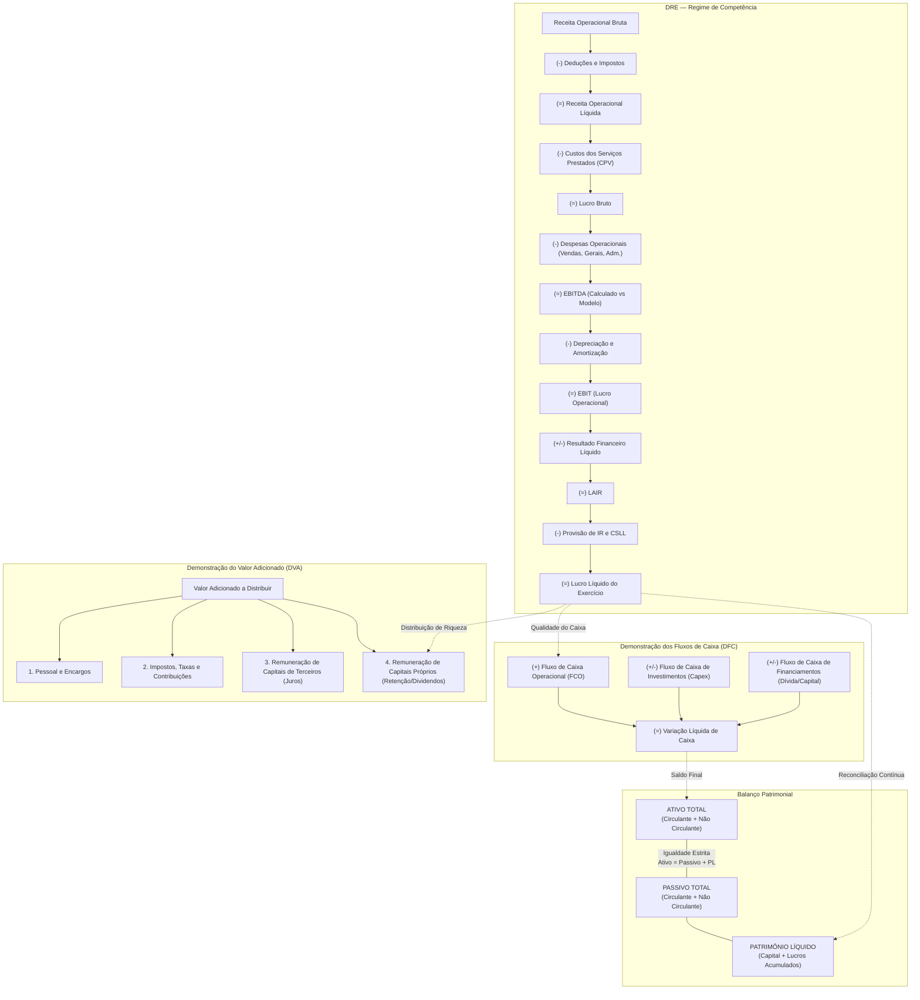

# CTI Global | Plataforma Analítica de Planejamento Financeiro
## Entrega 2 — Unidade Curricular: Contabilidade e Finanças

**Instituição:** Fundação Escola de Comércio Álvares Penteado — FECAP  
**Curso:** Bacharelado em Ciência da Computação — 4º Semestre (2026)  
**Projeto Interdisciplinar:** Plataforma Analítica de Planejamento Financeiro  
**Parceira Corporativa:** CTI Global  
**Unidade Curricular:** Contabilidade e Finanças  
**Etapa:** Entrega 02 – Painel Financeiro Operacional (Final — 4,0 Pontos)  
**Aplicação em Nuvem:** [https://dashboard-contatech.streamlit.app](https://dashboard-contatech.streamlit.app)  
**Repositório Oficial:** [https://github.com/BrenoColaneri/dashboard](https://github.com/BrenoColaneri/dashboard)  
**Credenciais de Acesso Institucional:** Usuário: `admin` | Senha: `admin123`

---

## 1. Identificação e Alinhamento com a Entrega 2

Conforme estabelecido na Matriz de Entregáveis Intermediários do Projeto Interdisciplinar (**Seção 11 do Documento de Requisitos**), a **Entrega 2 de Contabilidade e Finanças** exige a implementação no dashboard de:

> *"Uma visão financeira com margem, ticket, evolução, metas e demais indicadores definidos. Realizar análises de sensibilidade simples, como o impacto de desconto ou cupom na margem, ou de outra variável pertinente ao conjunto de dados. Os resultados devem ser consistentes com o dicionário de KPIs e com a planilha de validação."*

Este documento detalha como a plataforma atende integralmente a cada um desses requisitos contábeis e financeiros, incorporando também a expansão corporativa dos módulos de **Demonstração dos Fluxos de Caixa (DFC)**, **Capital de Giro e Prazos Médios**, **Fluxo de Caixa** e **Demonstração do Valor Adicionado (DVA)**.

---

## 2. Mapa das Funcionalidades Contábeis e Financeiras no Dashboard

A aplicação conta com **17 páginas analíticas**, das quais as seguintes são dedicadas exclusivamente à Controladoria, Contabilidade e Finanças:

| Página do Dashboard | Foco Contábil / Financeiro | Requisito Atendido |
| :--- | :--- | :--- |
| **1. Visão Executiva** | Síntese de alto nível com KPIs de margem, receita, lucro, rentabilidade e alertas contábeis automáticos. | Visão financeira executiva |
| **2. DRE — Demonstração do Resultado** | DRE completa estruturada por regime de competência, com decomposição vertical/horizontal e segregação estrita entre EBITDA Calculado e EBITDA do Modelo. | Demonstrações financeiras |
| **3. Balanço Patrimonial** | Estrutura patrimonial (Ativo Circulante, Realizável a Longo Prazo, Permanente/Imobilizado, Passivo Circulante, ELP e Patrimônio Líquido), com teste contínuo $Ativo = Passivo + PL$. | Estrutura patrimonial e solvência |
| **4. Fluxo de Caixa** | Comparativo entre regime de competência (Lucro Líquido DRE) e regime de caixa (Geração Líquida de Caixa), fluxo acumulado e conciliação bancária. | Conciliação DRE x Caixa |
| **5. Demonstração do Valor Adicionado (DVA)** | Cálculo da riqueza gerada pela CTI Global e sua distribuição aos Empregados, Governo (tributos), Credores (juros) e Acionistas (dividendos e retenção). | Distribuição de riqueza e ESG |
| **6. Indicadores Financeiros** | Consulta aos 62 KPIs agrupados por Liquidez, Rentabilidade, Endividamento, Estrutura de Capital, Prazos Médios, DFC e DVA. | Dicionário de KPIs interativo |
| **7. Índices da DFC** | Análise avançada da DFC: Índice de Qualidade do Caixa ($FCO / LL$), Cobertura de Investimentos ($FCO / Capex$), Amortização da Dívida e Sustentabilidade de Dividendos. | Análise avançada da DFC |
| **8. Capital de Giro e Prazos Médios** | Capital Circulante Líquido (CCL), Necessidade de Capital de Giro (NCG), Saldo de Tesouraria, PMR, PMP e Ciclo Financeiro Simplificado. | Gestão operacional de curto prazo |
| **9. Cenários e Rankings** | Posicionamento da CTI Global nos rankings corporativos (`Top 10 Lucro`, `Top 10 Margem Líquida`, `Top 10 ROE`, etc.) e comparador multicenário. | Benchmark e comparabilidade |
| **10. Evolução Financeira** | Análise de séries temporais do Ano 1 ao Ano 12, taxas de crescimento anual (CAGR) e tratamento transparente do Ano 12 incompleto. | Análise de evolução temporal |
| **11. Análise de Sensibilidade** | Simulador em memória de impactos na margem por variação de desconto comercial, cupom/preço, volume, custos variáveis, custos fixos e WACC. | Análise de sensibilidade exigida |
| **12. Metas Financeiras** | Painel de acompanhamento e monitoramento de metas operacionais e financeiras reais calculadas diretamente sobre o dataset oficial. | Metas operacionais e financeiras |
| **17. Metodologia e Indicadores** | Dicionário metodológico in-app com todas as 62 fórmulas, premissas de cálculo, normas contábeis aplicadas (NBC TG / IFRS) e fontes dos dados. | Dicionário formal de validação |

---

## 3. Demonstrações Contábeis Integradas e Reconciliação Contínua

A plataforma garante **100% de consistência contábil** em todas as demonstrações financeiras em relação à planilha oficial da CTI Global (`Contabilidade e Finanças.xlsx`):

### Regras de Auditoria e Reconciliação Contábil Automática (AUD-01 a AUD-05)

A cada carregamento de dados, o motor `src/data_validation.py` executa auditorias programáticas que atestam a higidez dos demonstrativos:

1. **AUD-01 (Equilíbrio Patrimonial):**  
   $$\text{Ativo Total} = \text{Passivo Circulante} + \text{Passivo Não Circulante} + \text{Patrimônio Líquido}$$  
   *Tolerância:* R$ 0,00 de resíduo em todos os cenários e períodos (Anos 1 a 11).
2. **AUD-02 (Integração DRE $\rightarrow$ Balanço):**  
   Reconciliação entre o Lucro Líquido apurado na DRE e a variação da conta de Lucros/Prejuízos Acumulados no Patrimônio Líquido.
3. **AUD-03 (Segregação de EBITDA):**  
   - $\text{EBITDA Calculado} = \text{EBIT} + \text{Depreciação/Amortização}$ (definição universal de Controladoria e IFRS).
   - $\text{EBITDA do Modelo} = \text{Valor original da coluna da planilha corporativa CTI}$.  
   A aplicação documenta expressamente a eventual divergência de arredondamento ou critério entre ambas as métricas.
4. **AUD-04 (Tratamento do Ano 12 Incompleto):**  
   O `Ano 12` da base oficial possui dados completos de resultado (DRE), mas não possui encerramento patrimonial (Balanço). A plataforma trata o `Ano 12` como `N/D` (Não Disponível) em indicadores que dependem de contas patrimoniais (ROA, ROE, Prazos Médios, CCL), impedindo imputações forçadas que violariam as normas contábeis.
5. **AUD-05 (Reconciliação DRE x DFC):**  
   Verificação de consistência entre a geração de lucro por competência e o caixa líquido gerado pelas operações (FCO).

---

## 4. Indicadores Operacionais e Financeiros Implementados

A plataforma cobre o catálogo completo de **62 Indicadores Auditados**, com destaque para as exigências da Entrega 2:

### 4.1. Indicadores de Margem e Rentabilidade
- **Margem Bruta (%):** $\frac{\text{Lucro Bruto}}{\text{Receita Líquida}} \times 100$
- **Margem Operacional (%):** $\frac{\text{EBIT}}{\text{Receita Líquida}} \times 100$
- **Margem EBITDA (%):** $\frac{\text{EBITDA}}{\text{Receita Líquida}} \times 100$
- **Margem Líquida (%):** $\frac{\text{Lucro Líquido}}{\text{Receita Líquida}} \times 100$
- **Retorno sobre o Ativo (ROA %):** $\frac{\text{Lucro Líquido}}{\text{Ativo Total Médio}} \times 100$
- **Retorno sobre o Patrimônio Líquido (ROE %):** $\frac{\text{Lucro Líquido}}{\text{Patrimônio Líquido Médio}} \times 100$
- **Retorno sobre o Capital Investido (ROIC %):** $\frac{\text{NOPAT}}{\text{Capital Investido}} \times 100$

### 4.2. Módulo de Capital de Giro e Prazos Médios
- **Capital Circulante Líquido (CCL):** $\text{Ativo Circulante} - \text{Passivo Circulante}$
- **Necessidade de Capital de Giro (NCG):** $(\text{Contas a Receber} + \text{Estoques}) - \text{Fornecedores}$
- **Saldo de Tesouraria (ST):** $\text{CCL} - \text{NCG}$ (Posição financeira líquida)
- **Prazo Médio de Recebimento de Vendas (PMR):** $\frac{\text{Contas a Receber Médias}}{\text{Receita Bruta}} \times 360$
- **Prazo Médio de Pagamento a Fornecedores (PMP):** $\frac{\text{Fornecedores Médios}}{\text{CPV / Compras}} \times 360$
- **Ciclo Financeiro Simplificado (dias):** $\text{PMR} - \text{PMP}$ (Mede o hiato de tempo entre o pagamento e a cobrança)

### 4.3. Módulo de Índices da DFC
- **Índice de Qualidade do Caixa:** $\frac{\text{Fluxo de Caixa Operacional (FCO)}}{\text{Lucro Líquido}}$ (Mede quanto do lucro reportado se converte em dinheiro efetivo).
- **Cobertura de Capex / Investimentos:** $\frac{\text{FCO}}{|\text{Capex}|}$ (Capacidade de autofinanciamento do crescimento).
- **Amortização da Dívida pelo Caixa:** $\frac{\text{FCO}}{\text{Serviço da Dívida / Financiamentos Líquidos}}$
- **Sustentabilidade dos Dividendos:** $\frac{\text{FCO}}{\text{Dividendos Pagos}}$

### 4.4. Demonstração do Valor Adicionado (DVA)
- **Valor Adicionado Líquido Produzido:** Riqueza gerada após insumos e depreciação.
- **Estrutura Percentual de Distribuição:**
  - $\% \text{ Pessoal}$ (salários, encargos e benefícios)
  - $\% \text{ Governo}$ (impostos diretos e indiretos, contribuições sociais)
  - $\% \text{ Remuneração de Capitais de Terceiros}$ (juros e aluguéis)
  - $\% \text{ Remuneração de Capitais Próprios}$ (dividendos e lucros retidos)

---

## 5. Painel de Análise de Sensibilidade Financeira

A **Página 11 (Análise de Sensibilidade)** atende diretamente ao requisito de *“análises de sensibilidade simples, como o impacto de desconto ou cupom na margem”*:

1. **Parâmetros Paramétricos Interativos em Memória:**
   - **Desconto Comercial Adicional (%):** Simula o efeito de políticas de desconto agressivas na Receita Bruta, Receita Líquida e Margem Líquida.
   - **Preço Médio / Cupom de Venda (%):** Simula campanhas de cupom promocional e reajustes na precificação.
   - **Volume de Operações / Serviços (%):** Choques de escala e capacidade produtiva.
   - **Custos Variáveis (%):** Sensibilidade à inflação de insumos e repasses de fornecedores.
   - **Custos e Despesas Fixas (%):** Eficiência em despesas administrativas e cortes de custos operacionais.
   - **Taxa de Desconto (WACC %):** Avaliação de valor presente e viabilidade de retorno econômico.
2. **Visualização de Impacto Imediato:**
   - Cartões de comparação: *Valor Base* vs *Valor Simulado* vs *Variação Absoluta* vs *Variação Percentual ($\Delta\%$)*.
   - Tabela detalhada de impacto em cascata na DRE (Receita Líquida $\rightarrow$ Margem Bruta $\rightarrow$ EBITDA $\rightarrow$ Lucro Líquido $\rightarrow$ Margem Líquida).
   - Gráfico dinâmico de tornado e curvas de sensibilidade.
3. **Simulador de Unit Economics (Ticket Médio, CAC e LTV):**
   - Relação $\frac{\text{LTV}}{\text{CAC}}$ estimada dinamicamente com base no Ticket Médio simulado, margem de contribuição e horizonte de retenção de clientes da CTI Global.

---

## 6. Painel de Metas Financeiras

A **Página 12 (Metas Financeiras)** permite a avaliação e o acompanhamento das metas corporativas:

- **Metas Auditadas e Reais:** As metas são baseadas nas premissas históricas e nas melhores práticas dos 1.200 cenários da CTI Global (ex.: Margem EBITDA $\ge 25\%$, Margem Líquida $\ge 12\%$, Liquidez Corrente $\ge 1,5$, Ciclo Financeiro $\le 45$ dias).
- **Sem Dados Fictícios:** Não foram inventadas metas artificiais sem fundamentação no dataset oficial.
- **Semáforo Gerencial Institucional:**
  - 🟢 **Verde (`#15803D`):** Meta superada ou atingida com folga.
  - 🟡 **Âmbar (`#B45309`):** Alerta operacional / próximo ao limite tolerável.
  - 🔴 **Vermelho (`#B91C1C`):** Meta não atingida / variação desfavorável que exige ação corretiva da controladoria.

---

## 7. Roteiro de Avaliação Rápida para o Professor / Avaliador

Para auditar o cumprimento dos requisitos de Contabilidade e Finanças, recomenda-se o seguinte fluxo de navegação no dashboard:

1. **Acessar a Plataforma:**
   - Abra o link: [https://dashboard-contatech.streamlit.app](https://dashboard-contatech.streamlit.app) (ou `http://localhost:8501` localmente).
   - Insira as credenciais: Usuário `admin` | Senha `admin123`.
2. **Conferir a DRE e o Balanço (Páginas 2 e 3):**
   - Alterne entre os cenários (ex.: `Cen_00001`, `Cen_00050`) e períodos (`Ano 1` ao `Ano 11`).
   - Observe a reconciliação automática $Ativo = Passivo + PL$ e a decomposição de Margem Bruta, EBITDA e Lucro Líquido.
3. **Explorar os Módulos de Caixa, DFC e DVA (Páginas 4, 5 e 7):**
   - Página 4: Observe a conciliação entre o Lucro Líquido por competência e o Caixa Líquido das Operações.
   - Página 5: Visualize o gráfico de pizza de distribuição da riqueza gerada pela CTI Global.
   - Página 7: Analise os índices de Qualidade do Caixa e Cobertura de Capex.
4. **Avaliar o Capital de Giro e Prazos Médios (Página 8):**
   - Verifique os cálculos de PMR, PMP, Ciclo Financeiro e a Necessidade de Capital de Giro (NCG).
5. **Testar a Análise de Sensibilidade e Metas (Páginas 11 e 12):**
   - Página 11: Mova os seletores de *Desconto Comercial* (-5% ou +10%) e *Volume de Vendas* e visualize instantaneamente a recomputação da Margem Líquida e do EBITDA.
   - Página 12: Verifique o semáforo gerencial de atingimento de metas.
6. **Consultar as Fórmulas e Regras Contábeis (Página 17):**
   - Acesse o dicionário in-app para checar a descrição formal de cada uma das 62 métricas calculadas.

---

## 8. Exportação de Relatórios Gerenciais (CSV, Excel e PDF)

A **Página 15 (Relatórios Gerenciais)** disponibiliza a exportação completa de todos os dados contábeis em três formatos corporativos:
- **Planilha Excel Multi-Abas (`.xlsx`):** Formatada profissionalmente com células em moeda brasileira (`R$ #.##0,00`), separador de milhar e abas dedicadas para DRE, Balanço, DFC, DVA e KPIs.
- **Relatório Executivo em PDF (`.pdf`):** Documento formal com cabeçalho institucional CTI Global, notas metodológicas, tabelas reconciliadas e parecer da controladoria.
- **Base Analítica em CSV (`.csv`):** Exportação com codificação UTF-8-BOM compatível diretamente com Excel e softwares de BI.
