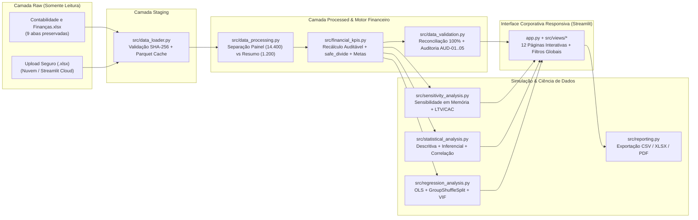
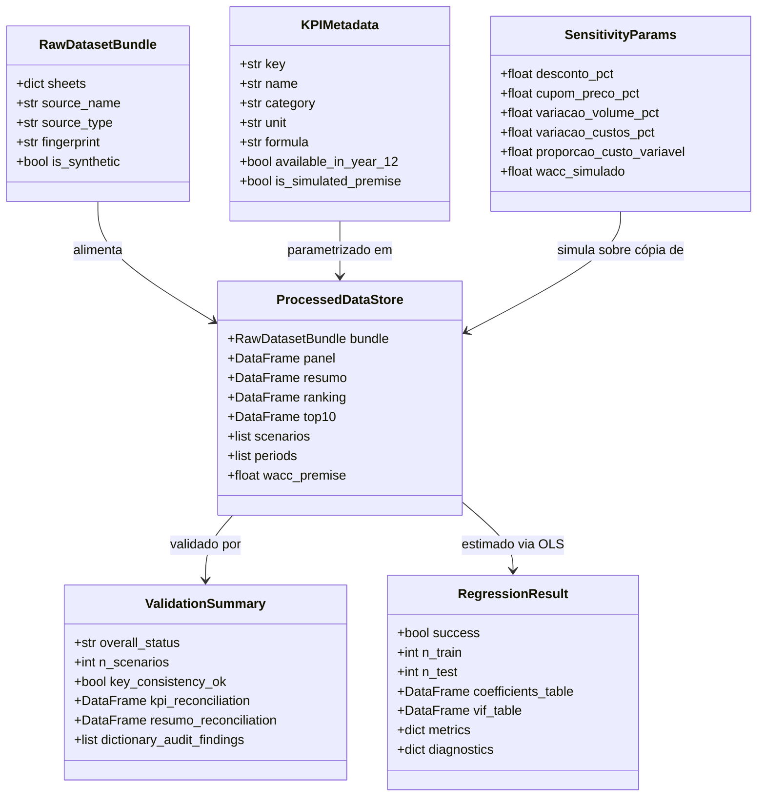

# Metodologia Analítica, Arquitetura de Software e Diagramas UML

**CTI Global | Plataforma Analítica de Planejamento Financeiro — Metodologia e Arquitetura**

Este documento descreve a engenharia de software, o fluxo de dados, os diagramas arquiteturais/UML e as metodologias financeiras, estatísticas e econométricas implementadas.

---

## 1. Arquitetura Modular da Aplicação (Fluxo de Componentes)

A solução segue separação rigorosa de responsabilidades (SoC), isolando leitura/cache (`data_loader`), transformação (`data_processing`), regras contábeis (`financial_kpis`), validação (`data_validation`), simulação (`sensitivity_analysis`), ciência de dados (`statistical_analysis`, `regression_analysis`), relatórios (`reporting`) e camada visual (`ui_components`, `charts`, `views/*`, `app.py`).

---

## 2. Diagrama de Classes / Estruturas de Domínio (UML)

---

## 3. Metodologia de Análise de Sensibilidade Financeira

Implementada em `src/sensitivity_analysis.py` (`run_financial_sensitivity`), opera estritamente sobre cópia profunda (`deep=True`) em memória:

1. **Multiplicador de Preço Líquido:** $f_{\text{preço}} = (1 - d) \times (1 + c)$, onde $d$ é o desconto comercial e $c$ é o ajuste de cupom/preço.
2. **Multiplicador de Volume:** $f_{\text{vol}} = 1 + \Delta v$.
3. **Receita Bruta Simulada:** $\text{Receita}_{\text{sim}} = \text{Receita}_0 \times f_{\text{preço}} \times f_{\text{vol}} \times (1 + \Delta r_{\text{extra}})$. Descontos reduzem a receita unitária sem reduzir o volume físico operacional a custear.
4. **Tributos sobre Vendas:** Mantêm a alíquota efetiva observada em cada período ($\text{Tributos}_0 / \text{Receita}_0$) quando a opção proporcional está ativa.
5. **Decomposição de Custos Fixos vs. Variáveis:** Dado o parâmetro $p_{\text{var}} \in [0, 1]$ (padrão `1,00` da proxy do modelo base) e o choque de custos $\Delta c_{\text{unit}}$:
   $$|\text{Custos}_{\text{sim}}| = |\text{Custos}_0| \times \left[(1 - p_{\text{var}}) + p_{\text{var}} \cdot f_{\text{vol}}\right] \times (1 + \Delta c_{\text{unit}})$$
6. **Propagação Contábil:** A variação incremental do Resultado Operacional ($\Delta \text{RO}$) propaga-se de forma exata para `EBITDA Calculado`, `EBITDA do Modelo`, `LAIR`, `IR/CSLL` (respeitando a alíquota efetiva quando `LAIR > 0`), `Resultado Líquido`, `NOPAT`, `ROIC` e `EVA` (recalculado com o `WACC` simulado).

---

## 4. Metodologia de Ciência de Dados (Estatística e Regressão OLS)

### 4.1. Separação Estrita de Populações Estatísticas
- **Nível Cenário (`Resumo_Cenarios`, $N = 1.200$):** 1 observação independente por cenário (média Anos 1–11). Validada com `100%` de concordância frente à aba `KPIs_Estatisticas`.
- **Nível Painel (`Cenário × Período`, até $14.400$ linhas):** Analisa observações anuais respeitando filtros ativos e aplica testes não paramétricos (Kruskal-Wallis) e testes de normalidade (Shapiro-Wilk).

### 4.2. Regressão Linear Múltipla (OLS) sem Vazamento Temporal
Implementada em `src/regression_analysis.py` (`fit_ols_regression`):
1. **Higienização:** Remoção documentada de `NaN`/`Inf` (como `Ano 12` patrimonial) e exclusão automática de regressores constantes.
2. **Prevenção de Vazamento Temporal (`GroupShuffleSplit`):** Quando estimada sobre o painel `Cenário × Período`, a partição Treino/Teste é agrupada pela chave `Cenário`. Assim, todos os períodos de um mesmo cenário ficam exclusivamente no treino ou exclusivamente no teste (`interseção = ∅`).
3. **Inferência Robusta:** Erros-padrão robustos a heterocedasticidade (`HC3`) no corte transversal de cenários e **erros-padrão clusterizados por `Cenário`** no painel longitudinal.
4. **Diagnósticos Econométricos:** Fator de Inflação da Variância (`VIF`), teste de Breusch-Pagan (heterocedasticidade), teste de Jarque-Bera (normalidade residual), estatística de Durbin-Watson e métricas dentro e fora da amostra (`R²`, `R² ajustado`, `MAE`, `RMSE`).
5. **Detector de Tautologia Contábil:** Alerta explícito caso o analista selecione preditores algebricamente derivados da variável dependente.

